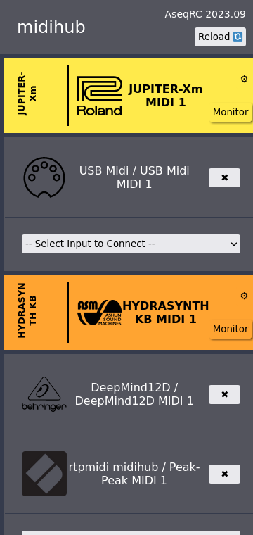
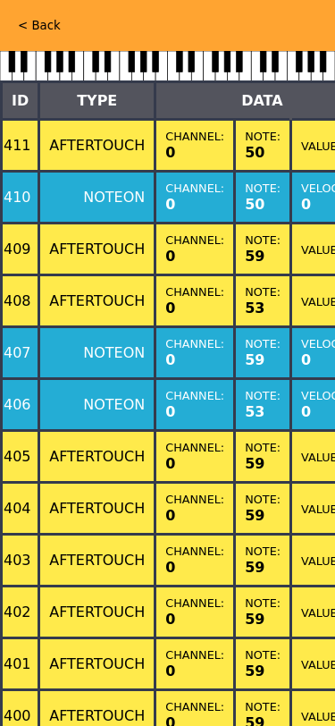

# Alsa Sequencer Remote Control

Creates an http server that allows to easily control alsa sequencer
connections.

I use it to connect all my MIDI gear to a Raspberry Pi, and control the
connections with my mobile.

Very handily it is packaged as a PWA, so it can be installed as an app from
the browser.

After installation it is available at http://IP and can be installed as a PWA 
(Google Chrome or Firefox, click add to home screen).

<a href="https://raw.githubusercontent.com/davidmoreno/aseqrc/master/screenshot1.png">
  
</a>
<a href="https://raw.githubusercontent.com/davidmoreno/aseqrc/master/screenshot2.png">
  
</a>


# Use

The patch screen shows the outputs, and you can add to which input it
is connected from the selector. Connections can be removed pressing
the x.

There is a `Monitor` button for each output that allows midi
monitoring for wasy troubleshooting.

All connections are remembered and if a device dissapears (unplugged
for example), when it reappears its reconnected. Same happens after
reboots.

My normal use case is always running in a raspberry pi, and all my
MIDI gadgets connected.

# Compile

```
make build
```

or 

```
make run
```

To develop you can do `make run` in one terminal an `make serve` in another, so any change on the 
frontend is automatic. The url would be http://localhost:8001. 

## ARM

It compiles and runs on 32 and 64 bit ARM. `alsaseq.go` used to need a couple
of lines changed by hand depending on the target; that is fixed and the same
source builds for amd64, armhf and arm64 (see `backend/alsaseq/alsaseq.go`,
the poll descriptor allocation and `unsafe.Slice`).

# Install

There are periodic releases at (github releases)[https://github.com/davidmoreno/aseqrc/releases]

Download latest, and install:

```
sudo dpkg -i aseqrc-latest_all.deb
```

There might be pending dependencies, which can be installed with:

```
sudo apt -f install
```

To start it run:

```sh
sudo service aseqrc start
```

To stop:

```sh
sudo service aseqrc stop
```

To always run

```sh
sudo systemctl enable aseqrc
```

To stop always run:

```sh
sudo systemctl disable aseqrc
```

# Packages

There are prebuilt packages for the usual suspects, and they are all built in a
container of the distribution and architecture they are for:

```sh
make packages                                   # ubuntu, debian and fedora, amd64/armhf/arm64
make deb-docker DISTRO=ubuntu-26.04 ARCH=armhf  # one .deb
make rpm        DISTRO=fedora-44    ARCH=aarch64 # one .rpm
```

`armhf` for 32 bit Raspberry Pi OS, `arm64` for everything newer. The artifacts
land in `packaging/out/` with checksums and a manifest, and `make -C packaging help`
lists all of it. See [packaging/README.md](packaging/README.md) for the details
(distributions, architectures, cross compilation with docker/QEMU, caching).

The binary can tell you what it is:

```sh
aseqrc -version
# aseqrc 23.09+7+gcd8e7cc (debian-13/arm64, commit cd8e7cc15021)
```

# Compile and Install

It has been developed and tested on Ubuntu 20.04. Older versions may need more work.

1. Install all required deps (open an issue if any missing):

```sh
apt install nodejs yarnpkg dh-make fakeroot
```

2. Create the deb package

```sh
make deb
```

The .deb file is created at the parent directory, on the machine you build it
on. For packages of other distributions and architectures use the docker based
build above instead: it does not need anything installed apart from docker.
